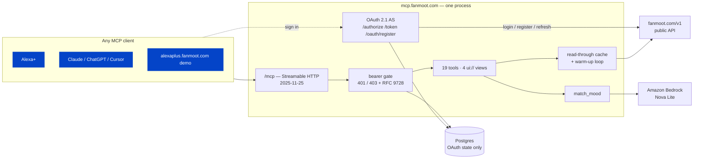
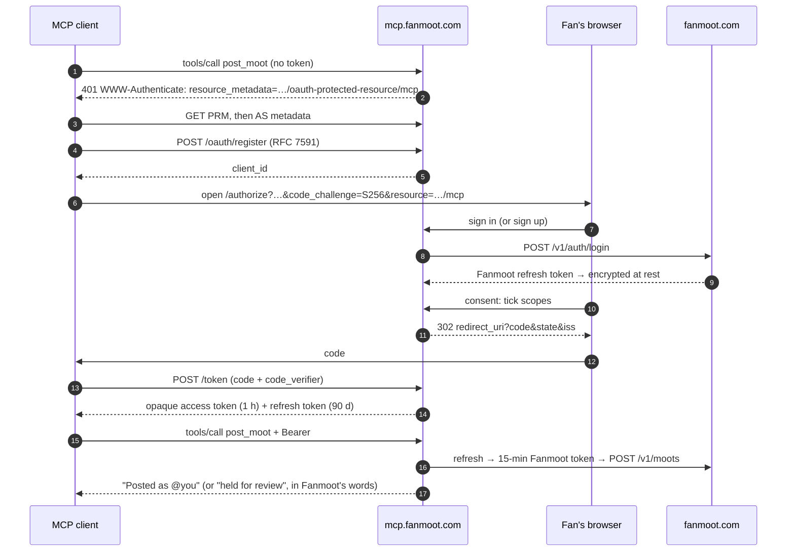

# fanmoot-mcp

A standards-compliant **Model Context Protocol** server that exposes
[Fanmoot](https://fanmoot.com) — where fans debate football — as tools,
resources and prompts, with its own OAuth 2.1 authorization server so a fan can
sign in *or sign up* from the client and then post in their own name.

Spec era **`2025-11-25`**, Streamable HTTP, on `POST|GET /mcp`.

**Live at `https://mcp.fanmoot.com/mcp`.** No account is needed to ask about
football. A fan who wants to post connects their Fanmoot account from inside
the client.

- [Connect a client](#connect-a-client) — Claude, ChatGPT, Cursor, VS Code, the
  Inspector, `curl`, and Alexa+
- [How it is built](#how-it-is-built) — architecture and the OAuth flow
- [Compliance](#compliance) — each requirement, where it is met and which test
  proves it
- [Operating it](docs/runbook.md) — deploy, roll back, rotate keys, the latency
  budget

## Sixty seconds

```bash
claude mcp add --transport http fanmoot https://mcp.fanmoot.com/mcp
```

Then ask *"what's on in the Premier League this weekend?"* or *"what are fans
saying about the Arsenal game?"*. Ask it to *"post that the second goal was
offside"* and your client opens a Fanmoot sign-in page. Sign in or create an
account, tick what it may do, and the take goes out under your handle.

Running it yourself:

```bash
make install && cp .env.example .env    # set FMCP_DATABASE_URL and FMCP_SECRET_ENCRYPTION_KEY
make migrate && make dev                # http://localhost:8080/mcp
make inspect                            # MCP Inspector, already pointed at it
```

## What it talks to

The server is a **client of Fanmoot's public API** (`https://fanmoot.com/v1/*`),
not of its database. It holds no model of Fanmoot's domain and shares no
connection pool with it. Everything the server can possibly do, a fan could do
through the public API.

Its own small PostgreSQL holds **OAuth state and nothing else**.

## What it can answer

Twelve read tools, no authentication. A client that connects can ask who is
playing tonight, what the score is, and what fans are saying about it.

| Tool | What a fan is asking |
|---|---|
| `find_club` | "the gunners", "spurs", "los blancos" → the club |
| `find_competition` | "the Prem" → the competition and its clubs |
| `list_matches` | "who are Arsenal playing", "how did they get on" |
| `upcoming_matches` | "what's on this weekend", grouped by day |
| `get_match` | "what's happening in the Brighton game" |
| `live_scores` | "what's the score", "is anything on" |
| `read_match_conversation` | "what are fans saying about it" |
| `read_thread` | one take and the argument under it |
| `search_fanmoot` | anything the others cannot place |
| `trending_takes` | "what's everyone talking about" |
| `club_news` | "any news about the transfer" |
| `match_mood` | "are fans happy", as three numbers and a sentence |

Four things hold across all of them, and they are the difference between a
voice surface and a REST API with a JSON-RPC envelope:

- **Nouns a fan says, not ids.** `get_match` takes `"arsenal vs spurs"`, a
  fanmoot.com link, or a UUID. A name that could mean three clubs comes back as
  a question — "Do you mean Arsenal, Aston Villa or Athletic Club?" — never as
  a guess.
- **An answer that can be read aloud.** Every result carries
  `structuredContent` for a machine *and* a `content[0].text` a model can speak
  unedited: "Arsenal are two-one up at the Emirates, sixty-seventh minute."
  One module writes all of them (`app/voice.py`), so the server has one voice.
- **Bounded output.** Five by default, twenty at the cap, declared in each
  tool's JSON Schema — and what was left out is said: "There are four more
  fixtures."
- **A score nobody observed is never stated.** Fanmoot marks a scoreline
  `assumed` when a server-side clock started the match and no source has
  confirmed anything since. Those come back as "under way, but nobody has
  confirmed a score yet".

`match_mood` is the one tool that is computed rather than fetched: it samples a
match's **public** thread and labels it with the server's own Bedrock call —
counts out with labels never stored, public moots only and never a handle, and
the moots framed as data rather than as instructions. With no model configured
it answers from an offline lexicon and says `"method": "lexicon"` in its
payload, so the tool is never simply down.

## What it can do for a linked fan

Seven more tools, each behind an OAuth scope the fan ticked on the consent
screen. These are what make Fanmoot a place to argue rather than a place to
read.

| Tool | What a fan is asking | Scope |
|---|---|---|
| `whoami` | "who am I on Fanmoot", "did that connect" | `fan.read` |
| `post_moot` | "post that", optionally anchored to a match | `moot.write` |
| `reply_to_moot` | answering somebody, in their thread | `moot.write` |
| `react_to_moot` | respect, heat, tactics, banter, offside | `moot.write` |
| `predict_match` | "call it two-one" | `predict.write` |
| `my_predictions` | what is called, and what is still open | `fan.read` |
| `follow` | a club, a competition or a fan | `fan.write` |

Three promises hold across the ones that write, and each is tested:

- **A retried frame posts once.** Every compose carries an idempotency key
  hashed from the grant, the JSON-RPC request id and the take itself. A client
  that retries after a dropped socket gets the moot the first attempt created;
  two different takes can never collide.
- **A held take is never reported as live.** Fanmoot's football-topicality gate
  can park a post for a moderator, and the answer says so, in Fanmoot's own
  words.
- **Nothing is trimmed.** A dictated take past the character cap comes back as
  "shall I shorten it?" rather than as a truncated opinion published under
  somebody's name.

Refusals from upstream reach the fan as something they can act on: an
unconfirmed email address says where to look for the link, a prediction after
kickoff says a take is still possible, and a rate limit says how long to wait.

## What it can show

Eight of the tools have a visual answer as well as a spoken one. A host that
supports the **MCP Apps** extension (`io.modelcontextprotocol/ui`, spec
`2026-01-26`) renders them; a host that does not gets the same sentence and the
same `structuredContent` it always got, which is the graceful degradation the
extension asks for.

| View | Rendered for | What it is |
|---|---|---|
| `ui://fanmoot/scoreboard` | `get_match`, `live_scores` | Crests, the scoreline, the live minute |
| `ui://fanmoot/thread` | `read_match_conversation`, `read_thread`, `trending_takes` | The takes, **and a composer that replies** |
| `ui://fanmoot/fixtures` | `list_matches`, `upcoming_matches` | A matchweek grouped by day |
| `ui://fanmoot/mood` | `match_mood` | The sentiment split as one bar and three counts |

The thread view is the one that is not a picture of an answer: its composer
calls `reply_to_moot` back through the host as a `tools/call`, on the same
connection and the same OAuth grant, so a fan reads the argument and answers it
without leaving the card.

Each view is a single self-contained HTML document. The declared CSP has **no**
`connectDomains` — the views never fetch, because everything they draw arrives
in a `ui/notifications/tool-result` — and one `resourceDomains` entry, Fanmoot's
own origin, for crests. Colours come from the host's theme variables where it
passes them and from Fanmoot's Floodlit palette where it does not; every text
pairing is measured against WCAG AA in the test suite rather than asserted.

## Authentication

The server is its **own OAuth 2.1 authorization server**. A fan signs in — or
signs up — on a Fanmoot-branded page here, chooses what the client may do, and
the client gets a token. It is never a Fanmoot access token: what a client holds
is an opaque handle to a grant row, and the server exchanges it for a
short-lived Fanmoot token per call. A leaked client token is revocable, expires
in an hour, and is meaningless to `fanmoot.com`.

| Endpoint | What |
|---|---|
| `/.well-known/oauth-protected-resource` | RFC 9728 — what `/mcp` is, and who authorizes it (also served at `…/oauth-protected-resource/mcp`) |
| `/.well-known/oauth-authorization-server` | RFC 8414 — every endpoint, and `code_challenge_methods_supported: ["S256"]` |
| `/.well-known/openid-configuration` | the same document, because some clients probe this path first |
| `GET /authorize` | authorization code + PKCE (S256 only) |
| `POST /token` | code exchange and rotating refresh |
| `POST /oauth/register` | RFC 7591 dynamic client registration |
| `GET /oauth/signup` | a **new fan** creating an account mid-flow |
| `POST /oauth/revoke` | RFC 7009 |
| `GET /oauth/connected` | a fan's connected apps, and a button to disconnect each |

Four scopes, because "let this thing use my account" is not one decision:
`fan.read`, `moot.write`, `predict.write`, `fan.write`. The consent screen names
each one in the words a fan reads and lets them untick any of it; the grant
records what was ticked, not what was asked for.

### Any client, not just Alexa

There are two tiers of client registration, and they land in the same table with
the same scopes:

- **Self-registering** — Claude, ChatGPT, Cursor and MCP Inspector register
  themselves through **RFC 7591** at `POST /oauth/register`, or identify
  themselves by a URL serving their own metadata (**SEP-991**, the mechanism
  `2025-11-25` recommends). Registration is open, with the guards that implies:
  per-address rate limiting, `https` redirect URIs plus `http://localhost` and
  `http://127.0.0.1` for loopback callbacks, a server-generated `client_id`, and
  a TTL that reaps registrations that never complete a grant.
- **Pre-seeded** — Alexa+ has no dynamic registration, so its credentials come
  from `FMCP_OAUTH_CLIENTS` and are upserted by `client_id` at every boot.
  Register *every* redirect URI from the Developer Hub: the presented one is
  matched exactly and never substituted for a default.

### What a client sees without a token

Nothing changes for the twelve read tools — they take no credential at all, and
"what's the score" is answerable without linking anything. A call to a tool that
acts as the fan comes back **401** with an RFC 9728 challenge naming the
protected-resource document, which is what Alexa starts account linking from and
what every other client discovers the authorization server from. A grant that is
missing one scope gets **403 `insufficient_scope`** naming what to ask for, so a
read-only link is upgraded rather than failed.

Without `FMCP_SECRET_ENCRYPTION_KEY` the server will not hold a fan's Fanmoot
session at all: `/authorize` answers 503 and the read tools carry on. That is the
safe direction, and `/healthz` reports it as `grant_storage: disabled`.

## Run it locally

```bash
make install          # uv venv + dependencies
cp .env.example .env  # then set FMCP_DATABASE_URL
make migrate
make dev              # http://localhost:8080
```

Or in Docker, which is what production runs:

```bash
make up               # docker-compose.yml + docker-compose.dev.yml
curl -s localhost:8080/healthz | python3 -m json.tool
```

`make check` is what CI runs — `ruff`, `mypy --strict`, `pytest`. A milestone
task is ticked only when it passes.

## Tests run offline, against a recorded Fanmoot

`fixtures/` holds real `/v1` responses captured from production by `make
record`. The suite drives the actual client — real timeouts, real retry policy,
real error mapping — against a transport that replays them, so it is fast,
deterministic and still asserting against shapes the API genuinely produced.
Nothing in `make check` touches the network or needs a database.

```bash
make record           # re-capture (needs network); writes fixtures/manifest.json
make record ARGS=-v   # …and print what each call returned
```

The authenticated endpoints are not recorded live — doing so would write a real
fan's handle and email into this repository — so their fixtures are hand-built
from Fanmoot's own schemas and marked `synthetic` in the manifest. `/v1/auth/*`
is stubbed per test for the same reason, one step further: a recording of a
sign-in is a recording of somebody's credentials being accepted.

The OAuth tests need *rows*, so they substitute an in-memory SQLite database and
create the schema from the models. That exercises the real queries — an
authorization code really is found by its hash, a replayed refresh token really
does revoke a family — and still leaves `make check` with nothing to install.

## Connect a client

One URL for every client: **`https://mcp.fanmoot.com/mcp`**, Streamable HTTP.
None of them needs a key or a client id. Each one registers itself (RFC 7591,
or a client ID metadata document) the first time it meets a tool that needs a
fan, then sends the fan through sign-in.

### Claude Code

```bash
claude mcp add --transport http fanmoot https://mcp.fanmoot.com/mcp
```

### Claude (desktop and web)

**Settings → Connectors → Add custom connector**, and paste the URL. For a
Claude Desktop that only runs local servers, bridge it with `mcp-remote` in
`claude_desktop_config.json`:

```json
{
  "mcpServers": {
    "fanmoot": { "command": "npx", "args": ["-y", "mcp-remote", "https://mcp.fanmoot.com/mcp"] }
  }
}
```

### ChatGPT

With developer mode on (**Settings → Apps & Connectors → Advanced**), create a
connector with the URL above and OAuth authentication. ChatGPT registers itself
and discovers the authorization server from the 401 challenge.

### Cursor

`~/.cursor/mcp.json`, or `.cursor/mcp.json` in a project:

```json
{ "mcpServers": { "fanmoot": { "url": "https://mcp.fanmoot.com/mcp" } } }
```

### VS Code

`.vscode/mcp.json`:

```json
{ "servers": { "fanmoot": { "type": "http", "url": "https://mcp.fanmoot.com/mcp" } } }
```

### MCP Inspector

```bash
make inspect MCP_URL=https://mcp.fanmoot.com/mcp
# or: npx @modelcontextprotocol/inspector --transport http --server-url https://mcp.fanmoot.com/mcp
```

### Any stdio-only client

`mcp-remote` turns the remote server into a local stdio one, OAuth included:

```bash
npx -y mcp-remote https://mcp.fanmoot.com/mcp
```

### Plain HTTP

No SDK is needed. The handshake, then a tool call on the session it opened:

```bash
URL=https://mcp.fanmoot.com/mcp
H=(-H 'Content-Type: application/json' -H 'Accept: application/json, text/event-stream')

SESSION=$(curl -si "${H[@]}" $URL -d '{"jsonrpc":"2.0","id":1,"method":"initialize",
  "params":{"protocolVersion":"2025-11-25","capabilities":{},"clientInfo":{"name":"curl","version":"1"}}}' \
  | awk -F': ' 'tolower($1)=="mcp-session-id"{print $2}' | tr -d '\r')
H+=(-H "Mcp-Session-Id: $SESSION" -H 'Mcp-Protocol-Version: 2025-11-25')

curl -s "${H[@]}" $URL -d '{"jsonrpc":"2.0","method":"notifications/initialized"}'
curl -s "${H[@]}" $URL -d '{"jsonrpc":"2.0","id":2,"method":"tools/call",
  "params":{"name":"live_scores","arguments":{}}}'
```

`make smoke` runs this conversation from Python, adds the discovery documents
and the 401 challenge, and checks every answer.

### Alexa+

The server implements Alexa's account-linking contract: a pre-seeded static
client (`FMCP_OAUTH_CLIENTS`), exact redirect-URI matching, PKCE S256,
`resource` on authorize and token, and refresh tokens always. It has **never
been connected to Alexa.** The Alexa+ MCP Toolkit is in preview with selected
partners, and Amazon confirmed it is not available to hackathon participants. The web demo at `alexaplus.fanmoot.com` drives this
server through a simulated Alexa+ surface instead.

[`alexa/addon.json`](alexa/addon.json) is the add-on manifest, written to
Amazon's documented schema and checked against it by `tests/test_addon.py`.
It has never been deployed or validated by Amazon's tooling. See
[`alexa/README.md`](alexa/README.md).

### Client compatibility

What each client does at registration, from connecting it to the deployed
server (`S7-10`). **Nothing in this table has been verified yet.** It is filled
in from real runs against `mcp.fanmoot.com`, and a failure here counts as a bug
in the server.

| Client | Registers via | Discovery path it reads | Signs in | Calls a write tool | Verified |
|---|---|---|---|---|---|
| Claude Code | | | | | not yet |
| Claude (custom connector) | | | | | not yet |
| Claude Desktop + `mcp-remote` | | | | | not yet |
| ChatGPT (developer mode) | | | | | not yet |
| Cursor | | | | | not yet |
| MCP Inspector | | | | | not yet |
| `curl` / `make smoke` | — (read tools and 401 only) | PRM, AS, OIDC | — | 401 as expected | not yet |

### What the transport does

- **Protocol `2025-11-25`**, the era Alexa+ implements. The SDK also ships the
  newer one; serving only that would fail the track, so the negotiated version
  is asserted in `tests/test_mcp_transport.py`.
- **Sessions**, with `Last-Event-ID` resumability: a client whose SSE stream
  drops reconnects quoting the last event it saw and is sent what it missed.
- **`Origin` validation**, returning `403` — a spec MUST and the defence
  against DNS rebinding. Non-browser clients send no `Origin` and are
  unaffected; browser origins are configured with `FMCP_MCP_ALLOWED_ORIGINS`.
- **Every JSON-RPC frame logged** with a request id, and one record per tool
  call with its duration and outcome. An inbound `X-Request-ID` is honoured, so
  a frame in the demo's trace panel and a line in these logs are the same
  event. No frame payloads and no tool arguments are ever logged.
- **Errors that teach**: a bad argument comes back as a tool execution error
  carrying a sentence a model can read aloud — "I still need club for that." —
  not a protocol error that ends the turn.

## How it is built



- **A client of Fanmoot's public API, not of its database.** Everything this
  server can do, a fan could do with `curl` against `fanmoot.com`.
- **Its own authorization server.** What a client holds is an opaque handle to
  a grant row. The server exchanges it for a 15-minute Fanmoot token per call,
  so a leaked client token is revocable, expires within an hour and is useless
  against fanmoot.com.
- **A cache that is a requirement.** Every read goes through a per-endpoint
  TTL cache with ETag revalidation. A loop keeps the live digest, the
  fortnight's fixtures, the catalogue and live matches' moods warm, so the
  first question after a quiet spell is not the slow one.

### The OAuth flow



## Compliance

The Alexa+ track's requirements and the MCP `2025-11-25` MUSTs, each with the
code that meets it and the test that proves it.

| Requirement | Met by | Proved by |
|---|---|---|
| MCP `2025-11-25`, negotiated exactly | SDK pinned `<2` (`pyproject.toml`) | `tests/test_mcp_transport.py`, `make smoke` |
| Streamable HTTP, one endpoint | `POST\|GET\|DELETE /mcp` (`app/mcp/transport.py`) | `tests/test_mcp_transport.py` |
| Resumable streams (`Last-Event-ID`) | `app/mcp/events.py` | `tests/test_mcp_events.py` |
| `Origin` validated, 403 on mismatch | `app/mcp/security.py` | `tests/test_mcp_origin.py`, `make smoke` |
| Input errors as tool errors, not protocol errors | `app/mcp/errors.py` | `tests/test_mcp_errors.py` |
| Tool icons, output schemas, `structuredContent` | `app/mcp/tools/` | `tests/test_tools_surface.py` |
| OAuth 2.1 code + PKCE **S256 only**, `plain` refused | `app/oauth/router.py`, `pkce.py` | `tests/test_oauth_flow.py` |
| RFC 9728 protected-resource metadata, bare and path-inserted | `app/oauth/metadata.py` | `tests/test_oauth_metadata.py` |
| RFC 8414 AS metadata with `code_challenge_methods_supported: ["S256"]` | `app/oauth/metadata.py` | `tests/test_oauth_metadata.py` |
| OIDC discovery path served | same document | `tests/test_oauth_metadata.py` |
| Resource indicators on authorize and token, not refresh | `app/oauth/router.py` | `tests/test_oauth_token.py` |
| Exact redirect-URI match, several per client, never defaulted | `app/oauth/clients.py` | `tests/test_oauth_flow.py` |
| Refresh tokens always; rotation with reuse detection | `app/oauth/grants.py` | `tests/test_oauth_token.py` |
| 401 / 403 with `WWW-Authenticate` from authenticated tools | `app/oauth/bearer.py` | `tests/test_oauth_challenge.py` |
| Incremental scope consent (SEP-835) | `app/oauth/bearer.py` | `tests/test_oauth_challenge.py` |
| Dynamic Client Registration (RFC 7591/7592) | `app/oauth/dcr.py` | `tests/test_oauth_dcr.py` |
| Client ID metadata documents (SEP-991), SSRF-fenced | `app/oauth/dcr.py` | `tests/test_oauth_client_metadata.py` |
| MCP Apps `ui://` views (`2026-01-26`) | `app/mcp/apps/` | `tests/test_apps_views.py`, `tests/test_apps_render.py` |
| < 500 ms (400 ms p95 budget per tool) | cache + warm-up + cached mood | `tests/test_latency.py`, `make latency` |
| Public HTTPS URL, HSTS | Dokploy + Traefik, `app/middleware.py` | `tests/test_security_headers.py`, `make smoke` |
| AWS service actually called | `match_mood` → Bedrock Converse (`app/mood.py`) | `tests/test_tools_mood.py` |

## Hardening

- **Latency.** `make latency` prints p50/p95 per tool from the `tool_calls`
  table, or drives a read workload at any URL with `--drive`. It exits 1 when a
  tool's p95 is over 400 ms. On 23 September 2026, a local server fetching live
  from fanmoot.com measured every tool's warm p95 under 70 ms, client-side.
- **Prompt injection.** A take reaches a model only as a quote after its
  poster's name, `Jo says: “…”`, with double quotes inside it made single so it
  cannot close itself. Bidi overrides, zero-width and control characters are
  stripped. The `match_mood` prompt's fence cannot be closed from inside a take.
  See `app/untrusted.py`.
- **Secrets.** The fan's Fanmoot session token is encrypted with a
  `MultiFernet` that takes a list of keys, so the key rotates without signing
  anyone out (`make rotate-keys`). Every other credential is stored as a
  SHA-256 hash. A structlog processor strikes credentials out of every log
  line. A revoked session's ciphertext is deleted. `tool_calls` has no column
  a body could go in.
- **Headers.** nosniff and `no-referrer` everywhere, HSTS from an `https`
  origin, and a script-free CSP with `frame-ancestors 'none'` on every HTML page.
- **Drift.** `make verify-live` replays the recordings against production, and
  runs on demand from a laptop, so it costs no CI minutes.

## Privacy

What the server keeps, and for how long, is at
[`/privacy`](https://mcp.fanmoot.com/privacy). The figures on that page are
rendered from the constants that enforce them. Terms are at
[`/terms`](https://mcp.fanmoot.com/terms).

## Licence

MIT. See [LICENSE](LICENSE).
